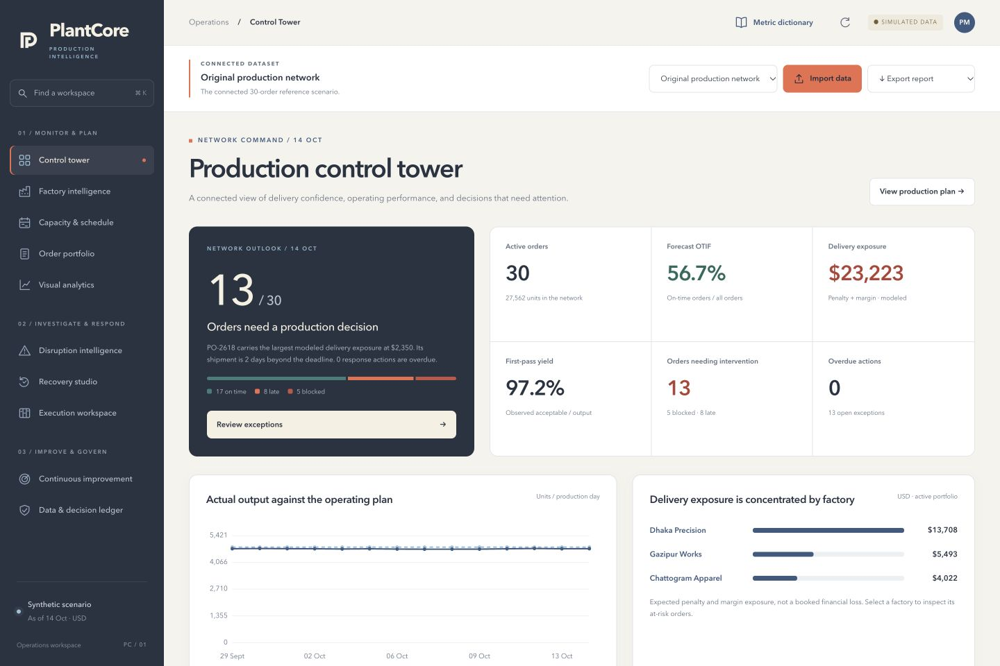

# PlantCore

<p align="center"><strong>Production intelligence for connected apparel networks</strong><br>Plan multi-factory production, recover from disruption, and turn operating evidence into better decisions.</p>

<p align="center"><a href="https://mah-era.github.io/PlantCore/">Live application</a> · <a href="https://github.com/Mah-era/PlantCore/actions">CI status</a> · <a href="project-report.md">Project report</a> · <a href="docs/requirement-coverage.md">Requirement coverage</a></p>



PlantCore is a desktop decision-support workspace for production managers, planners, quality teams, procurement, logistics, merchandising, finance, and factory leadership. It connects order allocation, capacity-constrained scheduling, disruption investigation, recovery economics, accountable execution, and continuous improvement in one operating model.

> **Try it now:** [Open the live PlantCore workspace](https://mah-era.github.io/PlantCore/). Import CSV, XLSX, or JSON and keep the analysis private in your browser.

## Why PlantCore

Production plans fail in connected ways: late fabric changes the schedule, machine failure consumes sewing capacity, a quality hold blocks downstream work, and a recovery decision shifts cost or risk to another order. PlantCore follows that chain from exception to cause, response, owner, evidence, and verified improvement.

It answers five operational questions:

1. Can every order still be produced and shipped on time?
2. What caused the exposure, and what evidence supports that conclusion?
3. Which recovery alternatives are operationally feasible?
4. What are the quality, cost, delivery, and commercial effects of each option?
5. Who must act, by when, and did the intervention work?

## Product surface

| Workspace | What it helps decide |
| --- | --- |
| **Control tower** | Which orders, factories, gates, and actions need attention? |
| **Factory intelligence** | Where are quality, attendance, rework, downtime, and delivery risks concentrated? |
| **Capacity & schedule** | Can cutting, sewing, finishing, inspection, packing, and shipment fit the calendar? |
| **Order portfolio** | Which allocation, release gate, and line assignment is feasible? |
| **Disruption intelligence** | What changed, what is affected, and which causes are hypotheses versus evidence? |
| **Recovery studio** | Which overtime, transfer, subcontracting, freight, or commitment option best balances QCD and cost? |
| **Execution workspace** | Who is accountable through RACI actions, dependencies, commitments, and escalations? |
| **Continuous improvement** | Does an intervention reduce recurrence at 30, 60, and 90 days? |
| **Data & decision ledger** | What source records, assumptions, decisions, and rule changes support the forecast? |
| **Visual analytics** | What do 30 file-driven views reveal about delivery, network, cost, capacity, quality, execution, and evidence? |

## Visual language

The interface uses the supplied PlantCore palette: a dependable blue foundation, a clear information accent, coral for intervention signals, and a warm off-white canvas for long analytical sessions.

| Color | Use |
| --- | --- |
| `#3D5A80` | Primary blue: navigation, headings, trusted actions |
| `#98C1D9` | Information blue: secondary states, charts, supporting UI |
| `#EE6C4D` | Signal coral: exceptions, risk, intervention emphasis |
| `#F5F1E3` | Warm canvas: reports, surfaces, calm reading areas |
| `#293241` | Ink navy: body text, contrast, dense data labels |

## Live application

The GitHub Pages build runs the same FastAPI application and Python calculation modules inside a browser Web Worker with Pyodide. SQLite is persisted in IndexedDB for the current browser profile. Uploaded files, decisions, commitments, and evidence do not leave the device.

1. Open [PlantCore on GitHub Pages](https://mah-era.github.io/PlantCore/).
2. Choose a built-in scenario or select **Import data**.
3. Upload an order CSV/XLSX or full network JSON.
4. Review the control tower, schedule, risks, recovery options, actions, and visual analytics.
5. Use **Export report** for management HTML, the JSON evidence pack, order forecast CSV, working scenario JSON, or the self-contained 30-view visual report.

The first visit downloads the Python runtime and packages, so allow a short startup and an internet connection. This is a private browser workspace, not an authenticated shared enterprise service.

## Run locally

Requires Python 3.10 or newer. CI uses Python 3.12.

```bash
python3 -m venv .venv
source .venv/bin/activate
pip install -r requirements.txt
uvicorn app.main:app --host 127.0.0.1 --port 8000 --reload
```

Open <http://127.0.0.1:8000/>. SQLite initializes at `data/platform.db`; set `PLANTCORE_DB` to use another path. The desktop interface targets a viewport of at least 1120 pixels.

### Docker

```bash
docker compose up --build
```

The Compose configuration binds the service to `127.0.0.1:8000`, stores SQLite in a named volume, runs as a non-root user, and exposes `/api/health`.

## Bring your own data

**Import data** accepts full network JSON (`schema_version: 1`, `meta`, and `data` collections), CSV/XLSX order tables (`Orders` sheet preferred), a JSON array of order rows, or `{ "orders": [...] }`.

Required order fields are `order_id`, `quantity`, `material_date`, and `due_date`. Supported aliases include `qty`, `deadline`, `factory`, `line`, and `style`. [Download the example order file](examples/sample-orders.csv).

Optional fields cover customer, factory/line/style metadata, category, machine, SMV, staffing, efficiency, stage capacity, cost, quality, reliability, logistics, priority, release gates, margin, and target cost. Files are limited to 3 MB and full-schema collections to 3,000 records each.

PlantCore discloses assumptions instead of silently fabricating evidence. Missing historical observations remain **N/A**. Conflicting factory or line attributes are rejected. Material shortages, unreleased quality, incompatible capability, missing machines, and compliance holds prevent infeasible allocations.

## Demonstration scenario

The packaged scenario contains three factories, eight lines, ten styles, and 30 orders. The recurring needle-failure case demonstrates the complete loop:

`risk detected → bottleneck identified → cause investigated → recovery compared → commitment approved → RACI actions assigned → outcome checked → planning rule proposed`

The 20 files in [`test-files/`](test-files/) cover steady operation, late material, recurring failure, absence, quality holds, rush orders, demand growth, maintenance, shutdown, transport, compliance, defect/rework growth, second shift, low-cost traps, complex styles, capacity pressure, combined disruption, quality–speed trade-offs, and unavailable machines. All packaged figures are synthetic.

## Validation

```bash
python -m unittest discover -s tests -v
python scripts/validate_scenarios.py
python scripts/validate_visualizations.py
node --check web/app.js
node --check web/enterprise.js
node --check web/visualizations.js
```

The regression suite covers scheduling constraints, quantity conservation, shared capacity, scenario isolation, file validation, exports, decision persistence, release gates, allocation, action dependencies, cost sharing, reproducible simulations, improvement guardrails, and all 30 visual aggregates. The live upload audit is documented in [`docs/live-upload-verification.md`](docs/live-upload-verification.md).

## Architecture

```text
CSV / XLSX / JSON → importers.py → scenarios.py → SQLite store
                                      ↓
                 engine.py + analytics.py + workflows.py
                                      ↓
                    FastAPI / browser worker → workspaces + exports
```

| Area | Location |
| --- | --- |
| Scheduling, allocation, recovery, benchmarks | `app/engine.py` |
| Portfolio, capacity, WIP, QCD, Monte Carlo | `app/analytics.py` |
| API, workflows, reports, static delivery | `app/main.py` |
| Event ledger and replay | `app/workflows.py` |
| SQLite persistence | `app/store.py` |
| Import and schema validation | `app/importers.py`, `app/scenarios.py` |
| Desktop UI and chart components | `web/` |
| Pyodide worker and Pages packaging | `site/`, `scripts/build_pages.py` |
| Regression and scenario sweep | `tests/`, `scripts/validate_scenarios.py` |

## Calculation boundaries

- Scheduling is a transparent daily-capacity heuristic, not a mathematical optimizer. It includes line sewing minutes, pooled factory stages, and a 12% initial changeover reservation.
- Current allocations place a whole order on one line. Detailed machine sequencing and multi-factory quantity splitting are outside the current model.
- Expected exposure is modeled penalty, contribution-margin, and probability exposure—not booked financial loss. Manufacturing cost is a proxy.
- Monte Carlo uses fixed-seed shipment-date shocks to test uncertainty assumptions; it is not a calibrated factory reliability model.
- Planned WIP comes from scheduled stage quantities. Actual OTIF and milestone adherence require confirmed shop-floor and shipment events.
- Named owners and approvers are recorded, but authentication, role enforcement, external notifications, ERP integration, and managed multi-user hosting are separate production concerns.

## Documentation

- [Project report](project-report.md) — technical design, formulas, development history, and operating limits.
- [Requirement coverage](docs/requirement-coverage.md) — feature-by-feature coverage review.
- [Live upload verification](docs/live-upload-verification.md) — browser audit of upload, recalculation, reload, and report export.

## License and status

PlantCore is an actively developed demonstration and decision-support platform using documented synthetic data. Review the calculation boundaries before using outputs in operational or commercial decisions.
